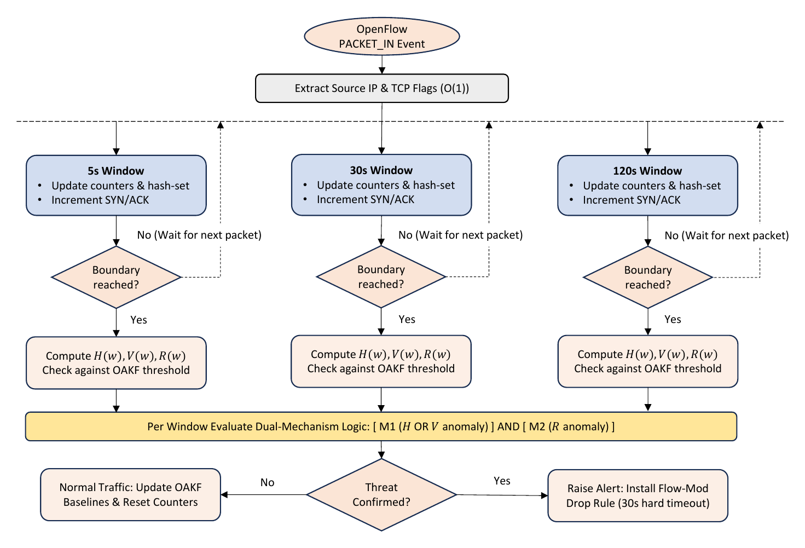

# Multi-Window, Dual-Mechanism SYN Flood Detection for SDN

A controller-resident detector for TCP SYN floods in Software-Defined Networking. It runs inside the Ryu controller, reads traffic at three time scales at once, and raises an alert only when two independent signals agree. Thresholds adapt to the live baseline through an Online Adaptive Kalman Filter. There is no machine-learning inference on the controller.

This repository holds the code and experiment harness for the paper:

> **Multi-Window, Dual-Mechanism Detection of TCP SYN Floods on the SDN Controller Without Machine-Learning Inference**
> Aiman Nurzharfan and Anazida Zainal, Faculty of Computing, Universiti Teknologi Malaysia.
> Accepted at the 6th International Cyber Resilience Conference (CRC 2026), Bangi, Selangor, Malaysia. IEEE proceedings, DOI to be added after publication.

[](LICENSE)


## Results at a glance

On the CIC-DDoS2019 TCP SYN flood, 30 independent chunks replayed live on a Ryu and Mininet testbed:

| Metric | Result |
| --- | --- |
| Detection rate (5 s window) | **95.5%** (547 of 573 attack cycles) |
| False positive rate | **0.078%** (1 of 1,289 calibration windows) |
| Processing cost | **0.111 ms** per detection cycle |
| Controller CPU added | +5.6 points of one core at 100 pps, +9.0 at 250 pps, nothing measurable once the controller saturates |

On BOUN, a spoofed multi-source flood mixed with live traffic from over 4,000 real users, the source-IP signals alone produce a 100% false positive rate. Requiring the SYN/ACK confirmation brings it to 0% while keeping 80.3% detection (100% of pulses detected).

## Why this design

Machine-learning detectors reach high accuracy but run inference on the same controller CPU that a SYN flood is already exhausting. Entropy detectors are cheap but usually read one window with a fixed threshold, so they miss attacks at other time scales or alarm when normal traffic drifts. This detector aims for the middle: high detection at a cost low enough that it never blocks the packet-handling loop.

## How it works



**Three concurrent windows (5, 30 and 120 s).** Every Packet-In event updates all three in constant time. The 5 s window catches onset, the 30 s window gives a stable reading of sustained floods, and the 120 s window is sized for slow-rate floods that stay under a short-window alarm.

**Three signals per window.**

| Signal | Definition | What it catches |
| --- | --- | --- |
| Source-IP entropy H(w) | Shannon entropy of the source address distribution | Floods that concentrate or randomise sources |
| IP revisit rate V(w) | Packets per unique source IP | Fresh spoofed sources, or one dominant source |
| SYN/ACK ratio R(w) | Inbound SYN over returned SYN-ACK | Handshakes that never complete |

**Two mechanisms that must agree.** Mechanism 1 fires on a source-IP anomaly (entropy or revisit rate). Mechanism 2 fires on a SYN/ACK anomaly. An alert needs both in the same cycle. A legitimate flash crowd disturbs the source-IP signals much like spoofing does, but it completes its handshakes, so Mechanism 2 stays quiet and no alert is raised. A one-window persistence rule holds an alert across a single dip at a pulse boundary.

**Adaptive thresholds.** Each of the nine signal-window instances has its own Online Adaptive Kalman Filter. The gain is recomputed every cycle from the innovation covariance, the threshold is three standard deviations of that covariance, and the filter does not update on a flagged cycle, so a flood cannot drag the baseline toward itself. Every step is plain arithmetic.

**Mitigation.** A confirmed alert installs an OpenFlow drop rule with a 30 s hard timeout.

## Ablation

Each component removed in turn (5 s window, 30 chunks):

| Mode | Detection rate | False positive rate |
| --- | --- | --- |
| FULL | 95.5 ± 4.5% | 0.078% |
| NO_MULTI_WINDOW (5 s only) | 94.9 ± 7.6% | 0.233% |
| NO_DUAL_MECH (Mechanism 1 only) | 94.5 ± 8.7% | **47.8%** |
| FIXED_THRESHOLD (static mean + 3 SD) | 95.3 ± 5.0% | 0.000% |

The dual-mechanism rule is what makes the detector usable. The extra windows mainly add stability, cutting the per-chunk spread from 7.6 to 4.5 points.

The adaptive threshold ties a tuned static threshold on stationary traffic. It earns its place when the baseline drifts: on a rising legitimate baseline it holds 100% detection at 0% false positives, while the best fixed threshold reaches 93% at 9% offline and 84% at 7% live.

## Testbed

- Ryu controller on OpenFlow 1.3
- Mininet tree topology: 5 switches, 20 hosts (15 legitimate, attacker on h16)
- CIC-DDoS2019 TCP SYN flood subset, split into 30 chunks of about 418,000 packets, replayed with tcpreplay at 5,000 pps
- 150 s calibration phase before attack injection in every trial
- BOUN spoofed flood replayed live through the same detector, code unchanged

## Repository layout

| Path | Purpose |
| --- | --- |
| `harness/detector/multi_window_detector_v2.py` | Ryu detection app: windows, Kalman thresholds, dual-mechanism gate, ablation modes |
| `harness/detector/oakf.py` | Online Adaptive Kalman Filter |
| `harness/scripts/experiment.py` | Runs one trial: starts Ryu and Mininet, calibrates, replays the attack, shuts down |
| `harness/traffic/legit_traffic_gen.py` | Legitimate background traffic for the calibration phase |
| `harness/analysis/compute_metrics.py` | Detection rate, false positive rate and processing time per window and mode |
| `topology/tree_5sw_20h.py` | Mininet tree topology (5 switches, 20 hosts) |
| `run_all.sh` | Batch runner: 30 chunks x 4 ablation modes = 120 trials |
| `run_long_test.sh`, `analyze_long_test.py` | Longer attack to exercise the 120 s window |
| `generate_report.py`, `make_thesis_figures.py`, `appendix_tables.py` | HTML report, figures and result tables |
| `logs/` | Result tables and figures from the experiments |

The BOUN cross-dataset validation and the non-stationary drift experiment live on the [`boun`](../../tree/boun) branch.

## Running the experiments

Requirements: Linux with Mininet, Open vSwitch and tcpreplay, plus Ryu in its own Python virtual environment (default `~/ryu-env`, override with `RYU_VENV`).

The CIC-DDoS2019 capture is not included. Download it from the Canadian Institute for Cybersecurity, extract the TCP SYN flood subset, and split it into `chunks/chunk_NNNNN.pcap` files.

```bash
# one trial: chunk 1, full system
sudo python3 harness/scripts/experiment.py 1 FULL run_001
# modes: FULL | NO_MULTI_WINDOW | NO_DUAL_MECH | FIXED_THRESHOLD

# all 120 trials (about 12 hours)
sudo bash run_all.sh

# results
python3 harness/analysis/compute_metrics.py logs
python3 generate_report.py logs
```

## Limitations

- One attack type (TCP SYN flood). UDP and ICMP floods would need a second protocol signal in place of the SYN/ACK ratio.
- The drift experiment uses a controlled synthetic baseline shaped like a daily load cycle.
- Controller CPU is measured directly; forwarding throughput is not.
- An attacker who paces SYNs or returns spoofed SYN-ACKs could keep the ratio inside its band, at the cost of most of the flood's volume.

## Citation

DOI pending. Until it is assigned, please cite:

```bibtex
@inproceedings{nurzharfan2026multiwindow,
  title     = {Multi-Window, Dual-Mechanism Detection of TCP SYN Floods on the SDN Controller Without Machine-Learning Inference},
  author    = {Nurzharfan, Aiman and Zainal, Anazida},
  booktitle = {Proceedings of the 6th International Cyber Resilience Conference (CRC 2026)},
  address   = {Bangi, Selangor, Malaysia},
  publisher = {IEEE},
  year      = {2026},
  note      = {Accepted. DOI to be added.}
}
```

## Datasets

- CIC-DDoS2019, Canadian Institute for Cybersecurity, University of New Brunswick.
- BOUN DDoS dataset, Bogazici University.

Both datasets belong to their authors and are used under their terms.

## License

MIT, see [LICENSE](LICENSE).
